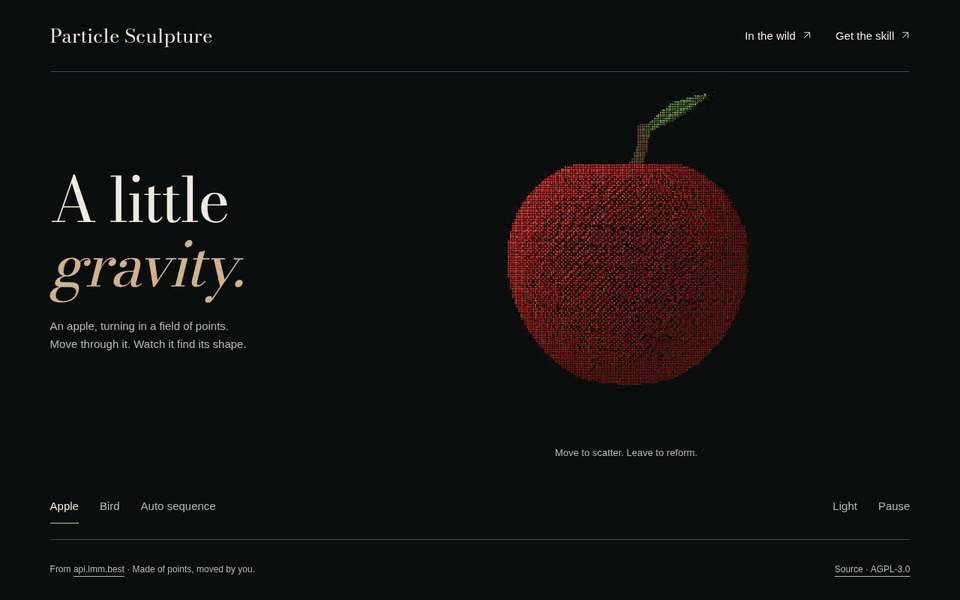

# Particle Sculpture Skill

把 [api.lmm.best](https://api.lmm.best/) 首页的 **3D 点云建模、关节动画、粒子转场、鼠标 / 触摸散开归位** 提取成一个独立的 Agent Skill。

[在线玩示例](https://lightjunction.github.io/particle-sculpture-skill/) · [X 实测展示](https://x.com/LIghtJUNction_x/status/2109308972499095657) · [技能入口](SKILL.md) · [制作方法](references/architecture.md) · [源码来源](NOTICE)



GIF 来自真实 Chromium 页面录制：苹果旋转 → 鼠标划过、粒子散开并恢复 → 鸟扑动翅膀 → 再次交互。可见光标跟随真实鼠标事件；没有用静态图冒充网页动画。

## 安装技能

```sh
git clone https://github.com/LIghtJUNction/particle-sculpture-skill.git ~/.codex/skills/particle-sculpture
```

在支持 `SKILL.md` 的 agent 中使用：

> 使用 $particle-sculpture 做一个旋转的苹果，再做一只扑翅膀的鸟。鼠标或触摸划过时，粒子散开，离开后恢复。保留手机滚动和暂停功能。

技能包含制作步骤、可以直接复制的运行代码和脚手架；不仅是一段提示词。

## 运行示例

```sh
git clone https://github.com/LIghtJUNction/particle-sculpture-skill.git
cd particle-sculpture-skill
python3 -m http.server 4177 --bind 127.0.0.1
```

打开 `http://127.0.0.1:4177`。选择 Apple / Bird，移动鼠标或划动手指；Auto sequence 演示粒子变形转场，Light 切换背景，Pause 暂停。

**页面运行零依赖**：原生 JavaScript 模块和 Canvas 2D，不需要 React、Three.js 或 WebGL。无需 npm 安装，也没有远程模型、字体或纹理请求。

## 用技能生成新页面

```sh
node scripts/create-demo.mjs --out /tmp/my-particle-demo
python3 -m http.server 4177 --bind 127.0.0.1 --directory /tmp/my-particle-demo
```

生成的目录可以独立运行。修改 `scenes.js` 定义你的物体：先采样三维表面，再通过 `part` 标记翅膀、叶子等部位，最后提供每帧的姿态变换。参考 [苹果 / 鸟的工厂函数](examples/apple-bird/scenes.js) 和 [架构说明](references/architecture.md)。脚手架拒绝覆盖已有目录。

## 本地验证与录制

需要 Node.js、Python 3；浏览器验证和录制额外使用 Playwright。录 GIF 需要 FFmpeg。

```sh
npm ci
npx playwright install chromium ffmpeg
npm test
npm run check:browser
npm run record
```

已有 Chromium 时可用 `CHROMIUM_PATH=/usr/bin/chromium npm run record`。录制输出到 `media/apple-bird.gif`，原始视频和测试收据放在 Git 忽略的 `output/playwright/`。参见 [录制说明](references/capture.md) 和 [实测记录](VALIDATION.md)。仓库没有日常自动 CI。

手机最多采样 22,000 个点，桌面最多 60,000，像素比上限 1.5；暂停、减少动态效果、数据节省和页面不可见时会限制动画。触摸保留竖向滚动与双指缩放。当前手机验证是 Chromium 触摸模拟，不代表实体手机性能测试。

## 来源与许可证

运行代码从 `TokenNotIncluded/api.lmm.best` 提取并适配，精确来源与修改范围见 [NOTICE](NOTICE)。保留 **[AGPL-3.0-or-later](LICENSE)**，没有改成 MIT。苹果和鸟是新的程序化造型，不是扫描模型。Bodoni Moda 字体使用 [SIL OFL](examples/apple-bird/BODONI-OFL.txt)。

## English

An agent skill for interactive 3D point-cloud sculptures, extracted from the api.lmm.best homepage. It includes reusable geometry samplers, depth-buffered Canvas rendering, articulated motion, scatter-and-reform pointer physics, passive touch handling, lifecycle controls and real browser-to-GIF recording.

Start with [SKILL.md](SKILL.md), serve this folder with any static HTTP server, or scaffold a standalone page with `node scripts/create-demo.mjs --out /path/to/new-demo`. Runtime: native ES modules, no packages. Development checks and recording: Playwright + FFmpeg. License: AGPL-3.0-or-later.
