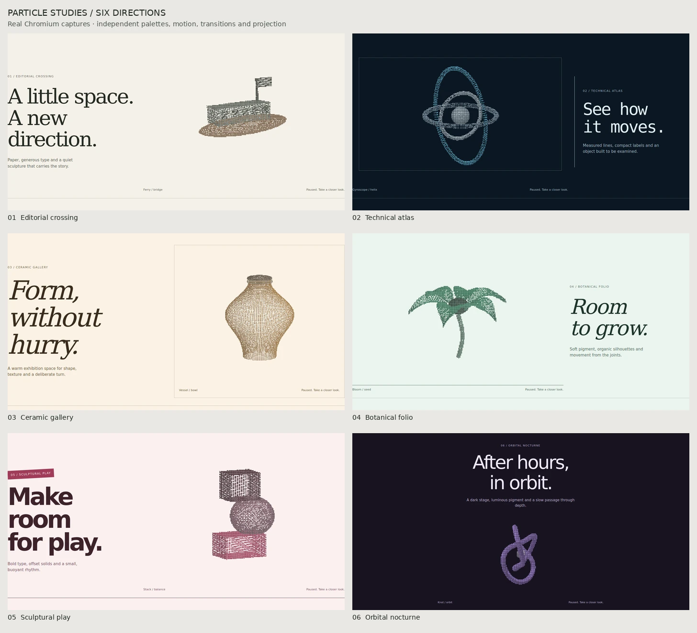

# Particle Sculpture Skill

把粒子首页做成可选择的设计系统：**构图、配色、物体运动、相机和转场独立选择**。运行代码源自 [api.lmm.best](https://api.lmm.best/)，本轮参考 [HireFerry](https://github.com/TokenNotIncluded/hireferry) 的首页叙事与主题设计。

[在线风格工作台](https://lightjunction.github.io/particle-sculpture-skill/assets/starter/) · [技能入口](SKILL.md) · [风格选择](references/design-directions.md) · [配色与动效](references/color-and-motion.md) · [原始苹果／飞鸟示例](https://lightjunction.github.io/particle-sculpture-skill/)



## 选风格，不套模板

| 风格 ID | 方向 | 示例形体 | 主要区别 |
| --- | --- | --- | --- |
| `editorial` | 纸墨叙事 | 渡船／拱桥 | 非对称留白、纸墨底色、轻微漂浮 |
| `blueprint` | 工程蓝图 | 陀螺仪／双螺旋 | 等宽字体、结构线、正交投影、部件运动 |
| `gallery` | 陶艺展厅 | 花器／碗 | 展品式边框、斜体大标题、缓慢转台 |
| `botanical` | 植物图谱 | 花朵／种子 | 有机曲面、柔和色彩、花瓣关节 |
| `playful` | 几何玩趣 | 堆叠／平衡 | 粗体、错位形体、有限弹性节奏 |
| `nocturne` | 深夜轨道 | 结环／轨道 | 居中舞台、多层深度、低速运动 |

工作台可以另外选择：

- **配色**：纸墨、海蓝、紫暮、玫瑰、琥珀、青绿，每组都有浅／深主题；界面和粒子材质同步。
- **转场**：直接形变、稳定点替换溶解、散开重组、直接切换；滑杆可来回预览，也可自动轮换。
- **运动**：缓慢转台、漂浮侧摇、轻微呼吸、部件运动、静止。
- **投影**：透视或正交；运行时还可配置缩放、点间距和指针扰动强度。

切换风格会保留你主动修改的选项；**Reset direction** 恢复当前风格默认值。当前组合写入 URL，便于分享。所有风格复用同一套运行时与页面，不复制六份实现。

技能在方向未定时给出三个有明显差异的候选和推荐，随后继续制作。更多印刷、粒子字体、分件展开及光学材质方向见参考文档；其中玻璃、物理光照、体积辉光需要另行实现 shader/WebGL，不冒充内置效果。

## 安装与生成

```sh
git clone https://github.com/LIghtJUNction/particle-sculpture-skill.git ~/.codex/skills/particle-sculpture
```

向支持 `SKILL.md` 的 agent 提出需求：

> 使用 $particle-sculpture 给我的网站提供三个不同的粒子首页方向。参考 HireFerry 的留白和叙事，配色要有浅深主题；不要固定成黑底旋转球。推荐一种，说明转场与 3D 动作，再完成可交互页面。

在技能目录执行：

```sh
node scripts/create-demo.mjs --list-styles
node scripts/create-demo.mjs --style blueprint --palette ocean --theme light \
  --motion articulate --transition dissolve --projection orthographic \
  --out /tmp/my-particle-demo
python3 -m http.server 4177 --bind 127.0.0.1 --directory /tmp/my-particle-demo
```

输出目录可以独立托管；脚手架拒绝覆盖已有目录。修改 `scenes.js` 和文案以对应实际产品。场景采样、材质角色、`seek()`、配置及清理 API 见 [架构说明](references/architecture.md)。

直接体验仓库：

```sh
python3 -m http.server 4177 --bind 127.0.0.1
```

打开 `http://127.0.0.1:4177/assets/starter/`。根路径保留苹果／飞鸟示例。

## 验证与边界

页面运行使用原生 ES 模块与 Canvas 2D，**没有运行时依赖或远程字体／纹理请求**。本地开发检查使用 Node.js、Python 3 和 Playwright；录 GIF 额外需要 FFmpeg。

```sh
npm ci
npx playwright install chromium
npm test
npm run check:browser
```

已有 Chromium 时设置 `CHROMIUM_PATH=/path/to/chromium`。`check:browser` 同时覆盖原始示例与风格工作台；可单独运行 `npm run check:studio`。实测范围见 [VALIDATION.md](VALIDATION.md)，录制方法见 [references/capture.md](references/capture.md)。

保留暂停、减少动态效果、离屏停帧、可读 DOM 内容、键盘操作、原生手机滚动与双指缩放。默认窄画布最多 22,000 个采样点、桌面最多 60,000，DPR 上限 1.5；这些是成本上限，不是实体设备帧率保证。当前手机验证为 Chromium 触摸模拟。

## 来源

运行代码与模型保留 **[AGPL-3.0-or-later](LICENSE)**；来源与修改范围见 [NOTICE](NOTICE)。HireFerry 的参考提交及设计依据见 [references/hireferry.md](references/hireferry.md)。程序化形体是风格示例，不是扫描模型。原始演示字体使用 [SIL OFL](examples/apple-bird/BODONI-OFL.txt)。

## English

A zero-runtime-dependency agent skill for interactive 3D particle websites. Compare six executable design directions, twelve procedural subjects, six paired palettes, four transitions, five pose modes and two projection modes in the [live studio](https://lightjunction.github.io/particle-sculpture-skill/assets/starter/). Start with [SKILL.md](SKILL.md); scaffold with `node scripts/create-demo.mjs --style editorial --out /path/to/demo`. Styles share one Canvas renderer and lifecycle owner. License: AGPL-3.0-or-later.
